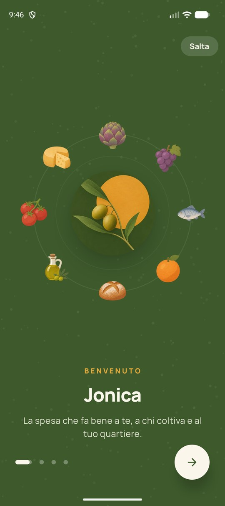
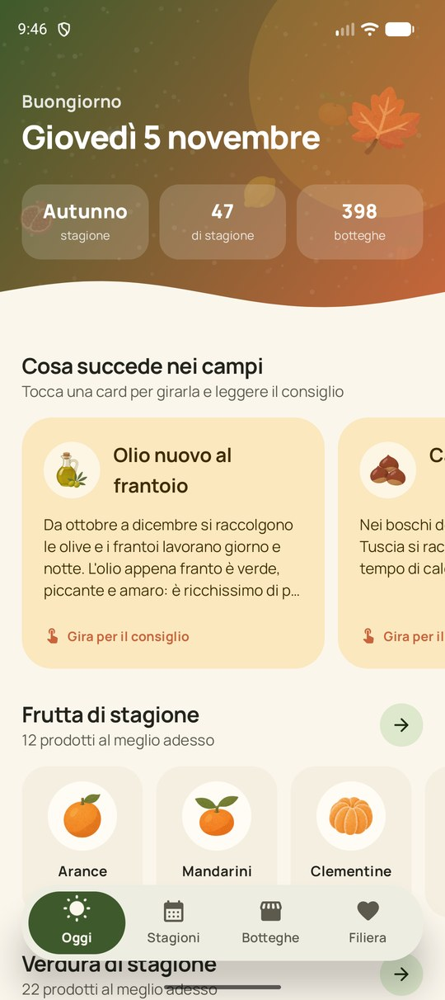
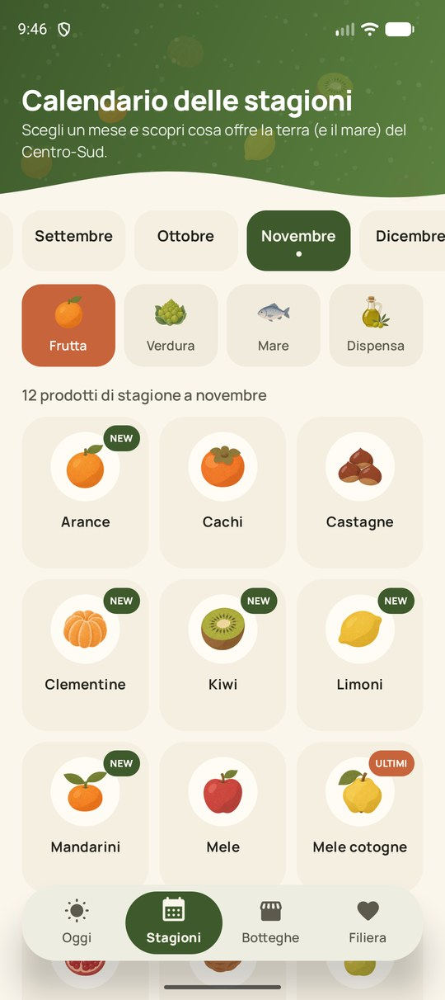
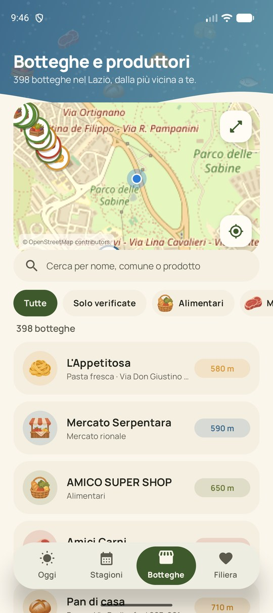
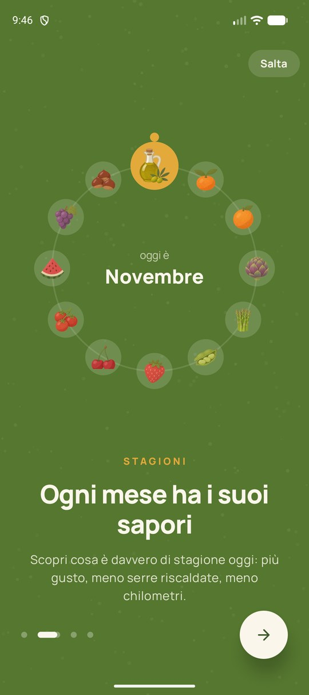
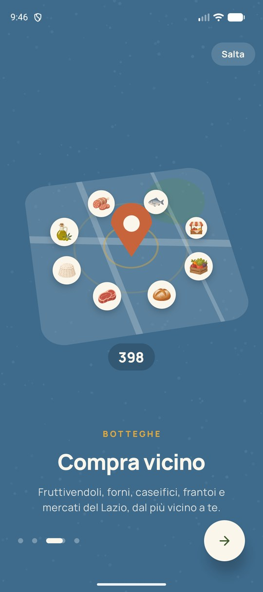
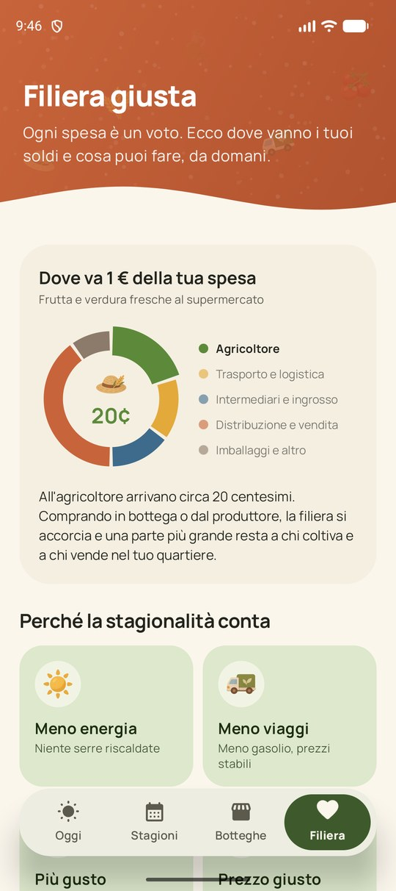
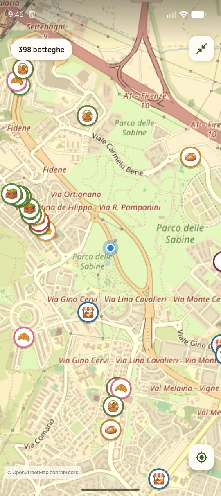
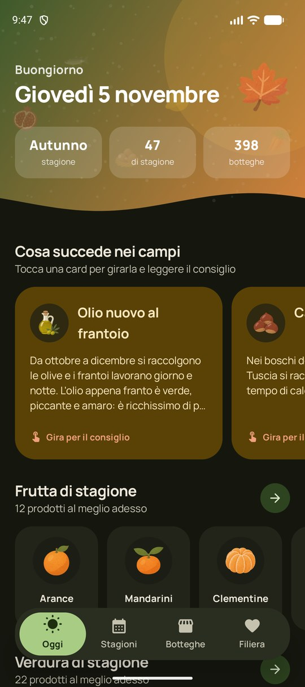

<p align="center">
  
</p>

<h1 align="center">Jonica</h1>

<p align="center">
  <b>Mangia di stagione. Compra vicino.</b><br>
  <a href="../../releases/latest">Scarica l'ultima versione</a>
</p>

<p align="center">
  
  
  
  
</p>

Jonica è un'app Android etica che aiuta a fare una spesa più consapevole:
scoprire cosa è davvero di stagione, capire dove vanno i soldi della spesa
e trovare le botteghe di quartiere (fruttivendoli, macellerie, forni,
pescherie, mercati rionali) vicino a te.

Nasce in un periodo di proteste di agricoltori e trasportatori, schiacciati
tra prezzi bassi all'origine e costi del carburante alti: comprare di stagione
e dalle botteghe locali accorcia la filiera e lascia più valore a chi produce
e a chi vende nel quartiere.

## Cosa trovi

- **Oggi**: la data, la stagione, cosa succede nei campi questo mese (olio
  nuovo al frantoio, vendemmia, castagne, fermo pesca…), frutta e verdura al
  meglio adesso, novità e prodotti agli sgoccioli, curiosità e la bottega più
  vicina.
- **Stagioni**: calendario mese per mese di frutta, verdura, pesce del Tirreno
  e dispensa (olio, ricotta, miele, legumi…), con consigli d'acquisto per ogni
  prodotto.
- **Botteghe**: mappa e lista di oltre 500 botteghe e piccoli produttori di
  Roma e del Lazio, con un focus su Colle Salario e il quadrante nord (fruttivendoli, macellerie, forni, caseifici, frantoi, norcinerie,
  cantine, mulini, apicoltori…), con ricerca, filtri per categoria e distanza
  dalla tua posizione.
- **Filiera**: dove va 1 € della spesa, perché la stagionalità conta, come
  leggere le etichette e una lista di piccoli impegni da spuntare.
- **Introduzione animata** al primo avvio, rivedibile da Filiera, e
  **aggiornamenti dall'app** tramite le release di GitHub.

## Screenshot

| Introduzione | | |
| :---: | :---: | :---: |
|  |  |  |

| Oggi | Stagioni | Filiera |
| :---: | :---: | :---: |
|  |  |  |

| Botteghe | Mappa a schermo intero | Tema scuro |
| :---: | :---: | :---: |
|  |  |  |

## Installazione

Scarica l'APK dall'ultima [release](../../releases/latest) e installalo sul
telefono (consenti l'installazione da origini sconosciute). Dalla versione
1.2.0 in poi gli aggiornamenti si installano direttamente dall'app.

## Sviluppo

Kotlin + Jetpack Compose, mappe con [osmdroid](https://github.com/osmdroid/osmdroid).
Nessun backend, nessuna chiave API: tutti i dati sono nell'app.

```bash
./gradlew assembleRelease
```

Le botteghe del quartiere 00138 sono estratte da OpenStreetMap: per aggiornarle,
riesegui la query Overpass salvando il risultato in `scripts/osm_shops.json` e
lancia `python scripts/gen_shops.py`.

Le botteghe del Lazio vengono dalla mappatura `scripts/data/botteghe_alimentari_lazio.json`.
Per aggiornarle:

```bash
python scripts/geocode_lazio.py scripts/data/botteghe_alimentari_lazio.json
python scripts/gen_lazio.py
```

Il primo script calcola le coordinate con Nominatim (una richiesta al secondo, con cache);
quando l'indirizzo non si trova usa il centro del comune e l'app lo segnala.

Le botteghe di Roma (priorità Colle Salario 00138) vengono da
`scripts/data/botteghe_alimentari_roma_00138.json`: `python scripts/gen_roma.py` le genera e
sostituisce i doppioni già presenti nelle altre due fonti.

## Crediti

- Mappatura "Botteghe alimentari e piccoli produttori del Lazio" (ricerca documentale su fonti pubbliche, novembre 2026): le schede del registro regionale sono indicate come "da verificare".
- Dati delle botteghe del quartiere, coordinate e mappe © [OpenStreetMap](https://www.openstreetmap.org/copyright) contributors (ODbL).
- Le stime sulla ripartizione del prezzo sono indicative e basate su studi ISMEA.
- Il calendario di stagionalità è indicativo per il Centro-Sud Italia.
- Font [Manrope](https://fonts.google.com/specimen/Manrope) (SIL Open Font License).
- Icone illustrate e icona dell'app create con ChatGPT; `scripts/slice_icons.py` le ritaglia dai fogli generati.
